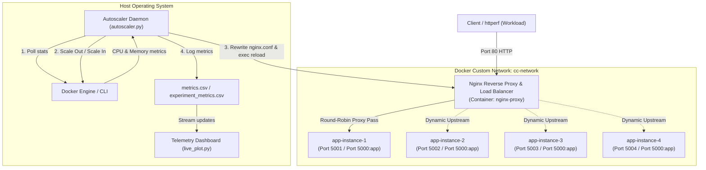
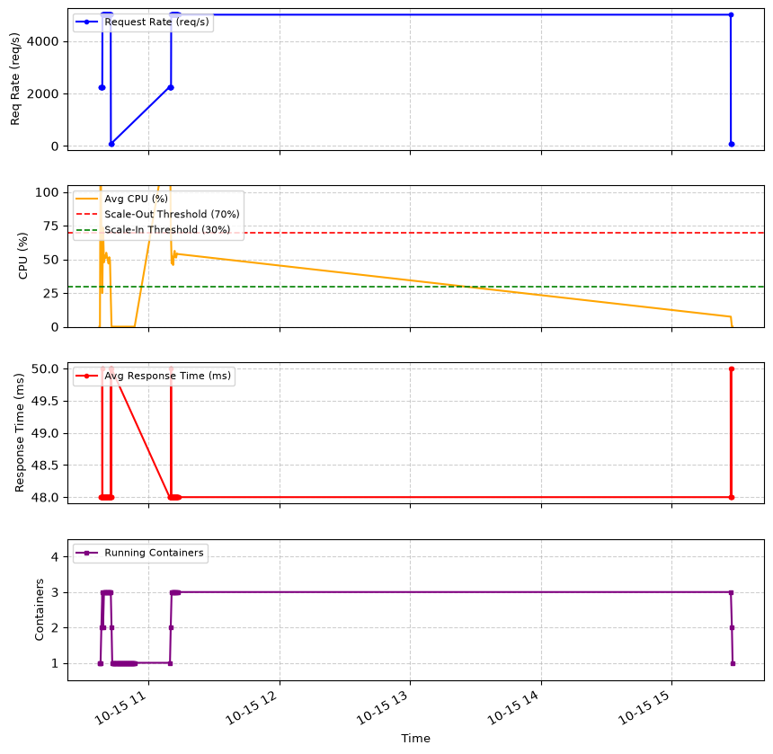

# Containerized Web Application Hosting, Load Balancing, and Automatic Scaling


An end-to-end cloud computing project demonstrating containerized microservice deployment, dynamic reverse proxy load balancing with Nginx, real-time resource telemetry, closed-loop autoscaling, and synthetic stress testing.

---

## 📌 Table of Contents
- [Project Overview](#-project-overview)
- [Architecture & Workflow](#-architecture--workflow)
- [Milestones & Implementation](#-milestones--implementation)
  - [Milestone 1: Quadratic Equation Solver Web App](#milestone-1-quadratic-equation-solver-web-app)
  - [Milestone 2: Docker Containerization with Resource Limits](#milestone-2-docker-containerization-with-resource-limits)
  - [Milestone 3: Dynamic Nginx Load Balancing](#milestone-3-dynamic-nginx-load-balancing)
  - [Milestone 4: Metrics Collection & Closed-Loop Autoscaler](#milestone-4-metrics-collection--closed-loop-autoscaler)
  - [Milestone 5: Synthetic Workload Generation & Performance Evaluation](#milestone-5-synthetic-workload-generation--performance-evaluation)
- [Project Structure](#-project-structure)
- [Prerequisites](#-prerequisites)
- [Quick Start Guide](#-quick-start-guide)
  - [1. Clone Repository](#1-clone-repository)
  - [2. Create Bridge Network & Build Image](#2-create-bridge-network--build-image)
  - [3. Start Initial Container & Nginx](#3-start-initial-container--nginx)
  - [4. Launch the Autoscaler](#4-launch-the-autoscaler)
  - [5. Run Workload & Live Dashboard](#5-run-workload--live-dashboard)
- [Autoscaling Rules & Policies](#-autoscaling-rules--policies)
- [Experimental Results & Verification](#-experimental-results--verification)
- [Author & Acknowledgments](#-author--acknowledgments)

---

## 📖 Project Overview

Modern cloud systems must dynamically scale compute resources in response to fluctuating user workloads while preserving high availability, low latency, and efficient resource utilization. 

This repository implements a production-style, containerized web service capable of:
1. Generating and computing solutions for random quadratic equations ($ax^2 + bx + c = 0$) handling real and complex roots.
2. Displaying server diagnostic metadata (hostname, container IP) to confirm traffic distribution.
3. Distributing incoming HTTP requests through an **Nginx** reverse proxy across healthy application replicas.
4. Monitoring container metrics (CPU % and Memory %) in real time.
5. Dynamically scaling container replicas between **1 and 4 instances** with automatic zero-downtime Nginx configuration reloads.
6. Stress testing under synthetic traffic generated with `httperf`, validated via real-time telemetry plotting.

---

## 🏗 Architecture & Workflow



---

## 🎯 Milestones & Implementation

### Milestone 1: Quadratic Equation Solver Web App
- Built a Flask web application (`app.py`) served with `gunicorn`.
- The `/solve` endpoint programmatically generates non-zero random coefficients $a, b, c \in [-10, 10]$ ($a \neq 0$), computes the discriminant $\Delta = b^2 - 4ac$, and accurately handles:
  - **Two Real Solutions** ($\Delta > 0$)
  - **One Real Solution** ($\Delta = 0$)
  - **Complex Conjugate Roots** ($\Delta < 0$)
- Injects `server_hostname` and `server_ip` into the response for cluster diagnostics and verification of proxy load distribution.
- Responsive user interface built with Bootstrap 5 and jQuery asynchronously fetching `/solve` updates.

### Milestone 2: Docker Containerization with Resource Limits
- Packaged the application into a lightweight `python:3.11-slim` container via `Dockerfile`.
- Configured 4 Gunicorn production workers listening on internal port `5000`.
- Applied strict hardware isolation constraints to enforce predictable cloud quota limits:
  ```bash
  docker run -d --name app-instance-1 \
    --network cc-network \
    --cpus="1.0" \
    --memory="1g" \
    -p 5001:5000 \
    quadratic-solver
  ```

### Milestone 3: Dynamic Nginx Load Balancing
- Deployed official `nginx:alpine` on port 80 to act as a reverse proxy and round-robin load balancer.
- Configured dynamic upstream backend targeting application containers via internal Docker DNS resolution (`app-instance-X:5000`).
- Validated request round-robin distribution by inspecting shifting server IPs and hostnames on client responses.

### Milestone 4: Metrics Collection & Closed-Loop Autoscaler
- Implemented `autoscaler.py`, an autonomous control loop running on the host:
  - **Telemetry Gathering**: Queries `docker stats --no-stream` every 15 seconds to parse individual and average CPU/memory usage across active replicas.
  - **Logging**: Persists telemetry records into `metrics.csv` (`timestamp,container_count,avg_cpu,avg_memory`).
  - **Scaling Decisions**:
    - **Scale-Out**: If average CPU > 70% and active replicas < 4, provisions `app-instance-(N+1)`.
    - **Scale-In**: If average CPU < 30% and active replicas > 1, drains and terminates the highest instance.
  - **Dynamic Nginx Synchronization**: Automatically regenerates `nginx.conf` with current container targets and triggers `docker exec nginx-proxy nginx -s reload` with zero client downtime.

### Milestone 5: Synthetic Workload Generation & Performance Evaluation
- Developed `run_test.py` utilizing `httperf` to simulate high-throughput client traffic:
  - **Phase 1 (Ramp-up)**: 150 conns/sec with 15 calls/conn (~2,250 req/sec) to trigger initial scale-out.
  - **Phase 2 (Sustained Peak Load)**: 250 conns/sec with 20 calls/conn (~5,000 req/sec) sustained over 220s to force horizontal scaling up to maximum capacity (4 containers).
  - **Phase 3 (Cooldown)**: Reduced traffic to allow CPU to drop below 30% and trigger systematic scale-in.
- Visualized live metrics via `live_plot.py`, producing multi-panel time-series graphs of workload, CPU utilization against thresholds, response times, and container count.

---

## 📂 Project Structure

```text
.
├── app.py                     # Flask application logic & quadratic solver API
├── autoscaler.py              # Autonomous metrics collector and scaling engine
├── Dockerfile                 # Multi-stage lightweight container specification
├── nginx.conf                 # Dynamic Nginx load balancer configuration
├── run_test.py                # Synthetic httperf workload runner (3-phase test)
├── live_plot.py               # Real-time multi-panel telemetry visualizer
├── requirements.txt           # Python library dependencies
├── templates/
│   └── index.html             # Web UI with jQuery, Bootstrap, and diagnostics
├── metrics.csv                # Sample system metrics logged during execution
├── experiment_metrics.csv     # Workload and latency records during benchmarks
├── live_dashboard.png         # Telemetry visualization output plot
├── .gitignore                 # Git ignore rules for virtual environments & logs
└── README.md                  # Comprehensive project documentation
```

---

## ⚙ Prerequisites

Before executing the project, ensure your host environment has:
- **Docker Engine / Docker Desktop** (with Linux containers enabled)
- **Python 3.10+**
- **Git**
- **httperf** (for load testing; available natively on Linux or via WSL2 / Docker on Windows)

---

## 🚀 Quick Start Guide

### 1. Clone Repository
```bash
git clone https://github.com/memrranmian/containerized-loadbalanced-autoscaler.git
cd containerized-loadbalanced-autoscaler
```

### 2. Create Bridge Network & Build Image
Create an isolated user-defined Docker bridge network so containers can communicate using container names:
```bash
# Create shared bridge network
docker network create cc-network

# Build application image
docker build -t quadratic-solver .
```

### 3. Start Initial Container & Nginx
Launch the baseline application container and Nginx proxy:
```bash
# Launch primary container (1 CPU, 1 GB RAM limit)
docker run -d --name app-instance-1 \
  --network cc-network \
  --cpus="1.0" --memory="1g" \
  -p 5001:5000 quadratic-solver

# Launch Nginx Load Balancer container
docker run -d --name nginx-proxy \
  --network cc-network \
  -p 80:80 \
  -v "${PWD}/nginx.conf:/etc/nginx/nginx.conf" \
  nginx:alpine
```
Access the application in your browser at `http://localhost`.

### 4. Launch the Autoscaler
In a separate terminal, start the autoscaling engine:
```bash
python autoscaler.py
```

### 5. Run Workload & Live Dashboard
To observe autoscaling in real time:
```bash
# Terminal 1: Start dashboard visualizer
python live_plot.py

# Terminal 2: Run synthetic load test
python run_test.py
```

---

## 📊 Autoscaling Rules & Policies

| Policy Attribute | Specification | Description |
| :--- | :--- | :--- |
| **Minimum Capacity** | `1 container` | Baseline instance `app-instance-1` is always kept alive. |
| **Maximum Capacity** | `4 containers` | Upper bound constraint to prevent host resource starvation. |
| **Scale-Out Trigger** | `Average CPU > 70.0%` | Dynamically starts `app-instance-(N+1)` and updates proxy upstream. |
| **Scale-In Trigger** | `Average CPU < 30.0%` | Gracefully drains and terminates the newest container. |
| **Sampling Interval** | `15 seconds` | Period between consecutive metric evaluations (`docker stats`). |
| **Upstream Reload** | `nginx -s reload` | Atomic reload ensuring zero dropped connections during topology shifts. |

---

## 📈 Experimental Results & Verification

During Milestone 5 benchmark experiments, the autoscaler was subjected to sustained high-throughput workloads delivering up to **5,000 requests/sec**.



### Key Observations:
1. **Ramp-Up (1 $\to$ 2 Containers)**: As the initial wave pushed CPU usage beyond the 70% threshold, the autoscaler triggered container 2 within 15 seconds.
2. **Peak Saturation (2 $\to$ 3 $\to$ 4 Containers)**: Under unbroken 5,000 req/s load, CPU demands caused sequential scale-out until reaching the configured maximum limit of 4 containers. Load was evenly partitioned across all 4 instances.
3. **Graceful Scale-In (4 $\to$ 1 Containers)**: Following workload termination, average CPU utilization settled below 30%, triggering safe sequential container teardown back to the minimum baseline of 1 container.

---

## 👤 Author & Acknowledgments

- **Author**: M Imran Mian
- **Roll Number**: MSDSF25A007
- **Course**: DS 584: Cloud Computing (Fall 2026)
- **Institution**: Faculty of Computing and Information Technology (FCIT), University of the Punjab
- **Instructor**: Dr. Muhammad Abdullah
